# 在线办公小程序--论文

> 🎓 **计算机毕业设计 · 在线办公小程序--论文**
>
> 本仓库只放**项目介绍 + 运行截图**（截图是站点带水印的原图，存在仓库 `images/` 里）。
>
> 👉 **完整可运行源码 / 数据库脚本 / 部署文档：[点我获取](https://geekcode.top/archives/%E5%9C%A8%E7%BA%BF%E5%8A%9E%E5%85%AC%E5%B0%8F%E7%A8%8B%E5%BA%8F-%E8%AE%BA%E6%96%87?utm_source=github)**
>
> 💬 咨询微信：**ir9372**　|　🌐 更多项目：[极客代码 geekcode.top](https://geekcode.top/?utm_source=github)
>
> 📌 项目详情页：<https://geekcode.top/archives/%E5%9C%A8%E7%BA%BF%E5%8A%9E%E5%85%AC%E5%B0%8F%E7%A8%8B%E5%BA%8F-%E8%AE%BA%E6%96%87?utm_source=github>

<table><td width="230" align="center"> <b>扫码加微信 ir9372</b></td><td valign="middle">📦 源码 = 项目介绍 + 全部运行截图 + 数据库 + 部署文档 👉 点上方任意截图，直接跳到 <b>极客代码 geekcode.top</b> 详情页</td></table>

---

<h1>在线办公小程序--论文</h1>
<h2>项目概述</h2>

本项目旨在开发一款基于微信小程序与 Java 后端架构的在线办公管理系统，核心目标是实现企业内部办公流程的数字化与移动化。系统主要服务于企业员工及行政管理人员，适用于日常考勤、通知公告发布、会议记录管理、工资信息查询及部门协同等场景。

技术架构上，前端采用微信小程序原生框架或 Vue 集成方案，提供轻量级的移动端交互体验；后端基于 Spring Boot 框架构建 RESTful API服务，使用 MyBatis-Plus 进行数据持久层操作，并引入 Apache Shiro 实现安全权限控制。数据库选用 MySQL 存储业务数据。通过前后端分离的设计模式，实现了高效的数据交互与业务逻辑解耦，满足了现代企业对移动办公便捷性与数据安全性的双重需求。

<h2>技术架构</h2>

本项目采用经典的前后端分离架构设计，具体技术选型与交互方式如下：

<h3>1. 整体架构</h3>
<ul>
<li><strong>前端（客户端）</strong>：微信小程序作为用户主要访问入口，负责界面展示、用户交互及请求发起。小程序端通过 <code>wx.request</code> 或封装后的 HTTP 库向后端发送异步请求。</li>
<li><strong>后端（服务端）</strong>：基于 Java 语言构建，核心框架为 Spring Boot。Spring Boot 提供了自动配置和快速启动能力，简化了 Web 应用的搭建过程。</li>
<li><strong>通信协议</strong>：前后端通过 HTTP/HTTPS 协议进行通信，接口遵循 RESTful 设计规范，数据交换格式统一采用 JSON。</li>
</ul>
<h3>2. 核心技术栈详解</h3>
<ul>
<li><strong>Web 层</strong>：使用 <code>spring-boot-starter-web</code> 提供 MVC 支持，处理 Controller 层的请求路由与响应。</li>
<li><strong>安全层</strong>：集成 <code>shiro-spring</code>，用于身份认证（Authentication）和授权（Authorization），确保只有合法用户才能访问特定资源，保护敏感数据如工资信息和个人隐私。</li>
<li><strong>数据持久层</strong>：</li>
<li>ORM 框架：采用 <code>mybatis-plus</code> 及其 starter，相比传统 MyBatis，MyBatis-Plus 提供了更便捷的 CRUD 操作和条件构造器，提高了开发效率。</li>
<li>数据库驱动：使用 <code>mysql-connector-java</code> 连接 MySQL 数据库。</li>
<li>JDBC 支持：包含 <code>spring-boot-starter-jdbc</code>，保障底层数据库连接的稳定性。</li>
<li><strong>工具类库</strong>：引入 <code>commons-lang3</code> 处理字符串与通用对象操作，<code>validation-api</code> 用于后端参数校验，<code>protobuf-java</code> 可能用于高性能数据传输或序列化优化（视具体业务模块而定）。</li>
</ul>
<h3>3. 数据库设计要点</h3>

根据后台路由 <code>/bumenxinxi</code> (部门信息), <code>/gongzixinxi</code> (工资信息), <code>/yuangong</code> (员工), <code>/zhiweixinxi</code> (职位信息), <code>/tongzhigonggao</code> (通知公告), <code>/huiyijilu</code> (会议记录), <code>/daibanshixiang</code> (待办事项) 等推断，数据库至少包含以下核心实体表：

<ul>
<li><strong>用户/员工表 (<code>user</code> / <code>yuangong</code>)</strong>：存储账号密码、个人信息、所属部门ID、职位ID等。</li>
<li><strong>部门表 (<code>bumenxinxi</code>)</strong>：存储部门名称、描述、上级部门关系等。</li>
<li><strong>职位表 (<code>zhiweixinxi</code>)</strong>：存储职位名称、职级、薪资范围标准等。</li>
<li><strong>工资表 (<code>gongzixinxi</code>)</strong>：关联员工ID，存储基本工资、奖金、扣款、实发工资及月份等信息。</li>
<li><strong>公告/通知表 (<code>tongzhigonggao</code>)</strong>：存储标题、内容、发布时间、作者等。</li>
<li><strong>会议记录表 (<code>huiyijilu</code>)</strong>：存储会议主题、时间、地点、参会人员、纪要内容等。</li>
<li><strong>待办事项表 (<code>daibanshixiang</code>)</strong>：存储任务标题、截止日期、状态（进行中/已完成）、责任人等。</li>
<li><strong>收藏表 (<code>storeup</code>)</strong>：存储用户对公告或资料的收藏记录。</li>
<li><strong>留言/消息表 (<code>messages</code>)</strong>：存储用户反馈或内部沟通留言。</li>
</ul>
<h2>功能模块</h2>

系统分为微信小程序用户端和 Web 后台管理端两个主要部分，各模块功能详细如下：

<h3>1. 微信小程序用户端</h3>

小程序面向普通员工和管理员，提供移动办公的核心功能。

<ul>
<li>
<strong>账户与安全模块</strong>

</li>
<li>
<strong>登录/注册</strong>：支持新用户注册及老用户登录，具备忘记密码找回功能。

</li>
<li>
<strong>个人中心</strong>：查看和编辑个人基本信息，包括头像、姓名、联系方式等。

</li>
<li>
<strong>我的收藏</strong>：列表展示用户收藏的通知公告或其他资料，支持查看详情。

</li>
<li>
<strong>信息发布与浏览模块</strong>

</li>
<li>
<strong>首页</strong>：展示最新的通知公告摘要、快捷入口及个人待办提醒。

</li>
<li>
<strong>通知公告</strong>：浏览公司发布的各类通知，点击可查看图文详情。

</li>
<li>
<strong>部门信息</strong>：查看公司组织架构及各部门的详细信息。

</li>
<li>
<strong>会议记录</strong>：浏览历史会议纪要，支持按时间或主题筛选查看详情。

</li>
<li>
<strong>留言板</strong>：查看其他用户的留言或发布自己的意见与建议。

</li>
<li>
<strong>个人事务管理模块</strong>

</li>
<li>
<strong>工资信息</strong>：员工可查询个人的月度工资明细，包括各项构成及实发金额。

</li>
<li>
<strong>待办事项</strong>：展示分配给当前用户的任务列表，支持查看任务详情及状态更新。

</li>
<li>
<strong>管理辅助模块（小程序端）</strong>

</li>
<li>
<strong>员工管理</strong>：管理员可在小程序端查看员工列表及员工详细信息。

</li>
<li>
<strong>职位管理</strong>：管理员可在小程序端查看职位信息列表。

</li>
</ul>
<h3>2. Web 后台管理端</h3>

后台面向系统管理员，提供全量的数据管理与配置功能。

<ul>
<li>
<strong>基础数据管理</strong>

</li>
<li>
<strong>部门信息管理 (<code>/bumenxinxi</code>)</strong>：对部门进行增删改查，维护组织架构树。

</li>
<li>
<strong>职位信息管理 (<code>/zhiweixinxi</code>)</strong>：定义岗位名称、职责描述及薪资等级。

</li>
<li>
<strong>员工信息管理 (<code>/yuangong</code>)</strong>：录入新员工档案，修改员工状态，分配部门与职位。

</li>
<li>
<strong>工资信息管理 (<code>/gongzixinxi</code>)</strong>：批量导入或手动录入员工薪资数据，审核工资发放情况。

</li>
<li>
<strong>内容与通讯管理</strong>

</li>
<li>
<strong>通知公告管理 (<code>/tongzhigonggao</code>)</strong>：发布、编辑、删除公司内部通知，控制可见范围。

</li>
<li>
<strong>会议记录管理 (<code>/huiyijilu</code>)</strong>：归档会议资料，上传会议纪要文档。

</li>
<li>
<strong>留言/消息管理 (<code>/messages</code>)</strong>：查看用户提交的留言，回复或屏蔽不良信息。

</li>
<li>
<strong>业务协作管理</strong>

</li>
<li>
<strong>待办事项管理 (<code>/daibanshixiang</code>)</strong>：创建任务并指派给特定员工，跟踪任务进度。

</li>
<li>
<strong>收藏管理 (<code>/storeup</code>)</strong>：监控用户收藏行为，分析热门内容（如有需要）。

</li>
<li>
<strong>系统配置</strong>

</li>
<li>
<strong>参数配置 (<code>/config</code>)</strong>：设置系统全局参数，如轮播图图片、网站标题、版权信息等。

</li>
<li>
<strong>文件管理</strong>：通过 <code>FileController</code> 处理图片、文档等非结构化数据的上传与存储。

</li>
</ul>
<h2>用户角色与权限</h2>

系统基于 Apache Shiro 实现细粒度的权限控制，主要划分为两类角色：

<h3>1. 普通员工（小程序用户）</h3>
<ul>
<li><strong>身份标识</strong>：通过手机号或工号注册登录的小程序用户。</li>
<li><strong>权限范围</strong>：</li>
<li><strong>只读权限</strong>：查看通知公告、部门信息、会议记录、职位信息（公开部分）、留言板内容。</li>
<li><strong>私有数据访问</strong>：仅能查看本人的工资信息、本人的待办事项、本人的收藏列表。</li>
<li><strong>写入权限</strong>：可以修改个人资料、发布留言、收藏公告、更新本人待办事项的状态（如标记完成）。</li>
<li><strong>限制</strong>：无法访问其他员工的私人数据（如他人工资），无法进入 Web 后台管理系统。</li>
</ul>
<h3>2. 系统管理员（Web 后台 &amp; 小程序管理端）</h3>
<ul>
<li><strong>身份标识</strong>：拥有 <code>admin</code> 角色的超级用户或具有特定管理权限的员工。</li>
<li><strong>权限范围</strong>：</li>
<li><strong>Web 后台全权访问</strong>：</li>
<li><strong>CRUD 操作</strong>：对部门、职位、员工、工资、公告、会议记录、待办事项、留言、系统配置进行完整的增加、删除、修改、查询操作。</li>
<li><strong>数据审计</strong>：查看所有用户的留言、收藏记录及系统日志。</li>
<li><strong>小程序端特权</strong>：</li>
<li><strong>人员管理视图</strong>：在小程序“管理端”页面中，可查看全部员工列表及详情页，查看职位信息列表。</li>
<li><strong>任务指派</strong>：可创建待办事项并分配给下属。</li>
<li><strong>安全控制</strong>：负责重置用户密码、禁用违规账号等操作。</li>
</ul>
<h2>项目特色与创新点</h2>
<ol>
<li>
<strong>多端协同的移动办公体验</strong>：
   不同于传统的 PC 端 OA 系统，本项目深度整合微信小程序生态。员工无需安装额外 APP，即可通过微信快速接入办公网络。这种“即开即用”的特性极大地降低了企业的推广成本和员工的使用门槛，特别适应碎片化时间的办公需求，如随时查看工资条、接收紧急通知。

</li>
<li>
<strong>基于 Shiro 的安全隔离机制</strong>：
   针对办公场景中高度敏感的“工资信息”和“个人隐私”，系统采用了 Apache Shiro 进行严格的身份验证与权限授权。通过数据层面的行级过滤（Row-Level Security 思想），确保普通员工只能访问自身数据，而管理员拥有全局视野，有效防止了数据泄露风险，符合企业信息安全规范。

</li>
<li>
<strong>模块化与可扩展的后端架构</strong>：
   后端采用 Spring Boot + MyBatis-Plus 组合，代码结构清晰，Controller 层与 Service 层职责分明。MyBatis-Plus 的动态 SQL 特性使得复杂查询（如多条件筛选员工、统计部门人数）的实现更加简洁高效。同时，RESTful API 的设计使得未来若需扩展 H5 页面或独立 App 客户端时，后端无需重构，仅需复用现有接口即可，具备良好的系统演进能力。

</li>
<li>
<strong>闭环的业务流程管理</strong>：
   从“通知公告发布”到“员工阅读/收藏”，从“待办事项指派”到“状态更新”，再到“会议记录归档”，系统覆盖了信息传达、任务执行、知识沉淀的全生命周期，形成了完整的内部管理闭环，提升了组织协作效率。

</li>
</ol>
<h2>部署环境</h2>

为确保项目正常运行，需准备以下软硬件环境：

<h3>1. 硬件环境</h3>
<ul>
<li><strong>服务器</strong>：建议 CPU 2核以上，内存 4GB 以上，硬盘空间 20GB 以上（用于存储 MySQL 数据及上传的文件）。</li>
<li><strong>开发机</strong>：普通 PC 即可，推荐内存 8GB 以上以流畅运行 IDE 和微信开发者工具。</li>
</ul>
<h3>2. 软件环境</h3>
<ul>
<li><strong>操作系统</strong>：Linux (CentOS 7+/Ubuntu 20+) 或 Windows Server/Linux Desktop。</li>
<li><strong>JDK</strong>：Java Development Kit 1.8 或更高版本（推荐 JDK 8 或 JDK 11，需与 Spring Boot 版本兼容）。</li>
<li><strong>数据库</strong>：MySQL 5.7 或 MySQL 8.0+。需配置字符集为 <code>utf8mb4</code> 以支持 Emoji 及部分特殊符号。</li>
<li><strong>Maven</strong>：Apache Maven 3.6+，用于依赖管理和项目构建。</li>
<li><strong>Node.js</strong>：如果前端涉及 Vue 编译或小程序打包工具链，需安装 Node.js (LTS 版本)。</li>
<li><strong>微信开发者工具</strong>：官方最新版，用于小程序前端的调试、预览和代码上传。</li>
<li><strong>IDE</strong>：IntelliJ IDEA (推荐) 或 Eclipse，用于 Java 后端开发。</li>
</ul>
<h3>3. 部署步骤简述</h3>
<ol>
<li><strong>数据库初始化</strong>：安装 MySQL，创建数据库，执行 SQL 脚本导入表结构和初始数据（如管理员账号）。</li>
<li><strong>后端部署</strong>：修改 <code>application.yml</code> 中的数据库连接信息、端口号等配置。使用 Maven 打包生成 jar 包，通过 <code>java -jar</code> 命令启动服务。</li>
<li><strong>前端配置</strong>：在微信开发者工具中导入小程序源码，修改 <code>app.js</code> 或配置文件中的后端 API 地址指向本地或线上服务器 IP。</li>
<li><strong>域名与 HTTPS</strong>：正式上线时，微信小程序要求后端接口必须使用 HTTPS 协议，需配置 SSL 证书并绑定备案域名。</li>
</ol>
<h2>五、技术特性</h2>
<ul>
<li>前后端集成部署，前端资源打包至后端 static 目录</li>
<li>使用 MyBatis-Plus 简化数据访问层开发</li>
<li>集成 Shiro 权限框架实现角色权限控制</li>
</ul>
<h2>六、功能模块截图</h2>
<h3>微信小程序用户端</h3>

<figure><a href="https://geekcode.top/archives/%E5%9C%A8%E7%BA%BF%E5%8A%9E%E5%85%AC%E5%B0%8F%E7%A8%8B%E5%BA%8F-%E8%AE%BA%E6%96%87?utm_source=github" title="查看完整源码">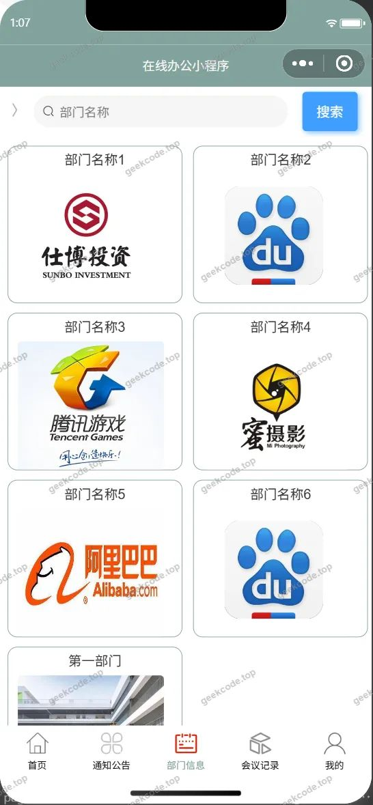</a><figcaption>小程序-部门信息</figcaption></figure>
<figure><a href="https://geekcode.top/archives/%E5%9C%A8%E7%BA%BF%E5%8A%9E%E5%85%AC%E5%B0%8F%E7%A8%8B%E5%BA%8F-%E8%AE%BA%E6%96%87?utm_source=github" title="查看完整源码">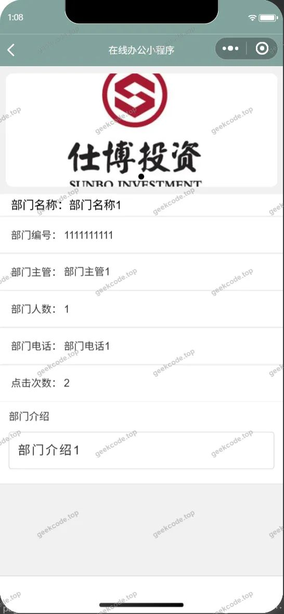</a><figcaption>小程序-部门信息详情</figcaption></figure>
<figure><figcaption>小程序-待办事项列表</figcaption></figure>
<figure><a href="https://geekcode.top/archives/%E5%9C%A8%E7%BA%BF%E5%8A%9E%E5%85%AC%E5%B0%8F%E7%A8%8B%E5%BA%8F-%E8%AE%BA%E6%96%87?utm_source=github" title="查看完整源码">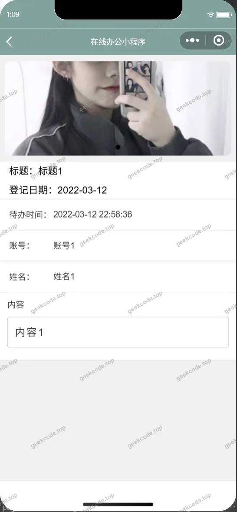</a><figcaption>小程序-待办事项详情</figcaption></figure>
<figure><a href="https://geekcode.top/archives/%E5%9C%A8%E7%BA%BF%E5%8A%9E%E5%85%AC%E5%B0%8F%E7%A8%8B%E5%BA%8F-%E8%AE%BA%E6%96%87?utm_source=github" title="查看完整源码">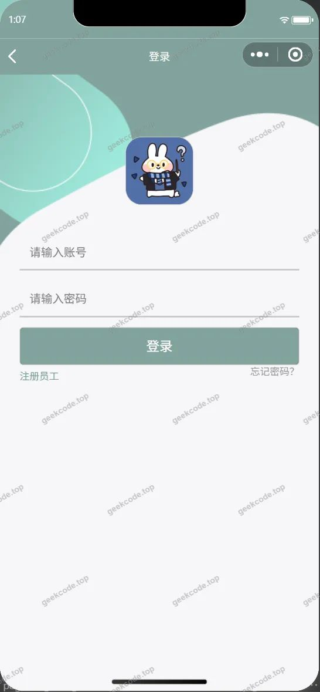</a><figcaption>小程序-登录</figcaption></figure>
<figure><a href="https://geekcode.top/archives/%E5%9C%A8%E7%BA%BF%E5%8A%9E%E5%85%AC%E5%B0%8F%E7%A8%8B%E5%BA%8F-%E8%AE%BA%E6%96%87?utm_source=github" title="查看完整源码">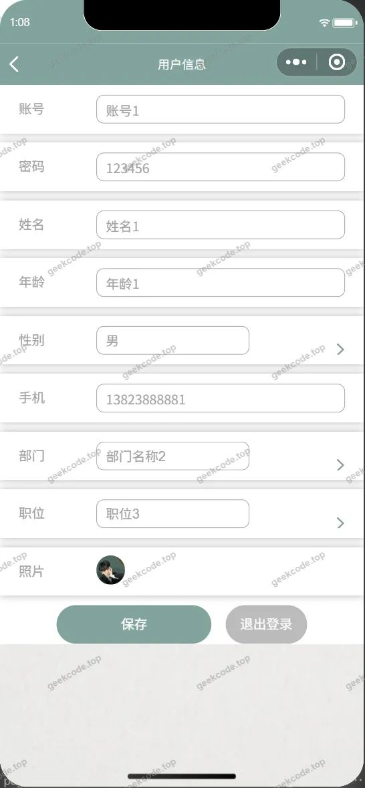</a><figcaption>小程序-个人信息</figcaption></figure>
<figure><figcaption>小程序-工资信息列表</figcaption></figure>
<figure><figcaption>小程序-工资信息详情</figcaption></figure>
<figure><figcaption>小程序-会议记录</figcaption></figure>
<figure><a href="https://geekcode.top/archives/%E5%9C%A8%E7%BA%BF%E5%8A%9E%E5%85%AC%E5%B0%8F%E7%A8%8B%E5%BA%8F-%E8%AE%BA%E6%96%87?utm_source=github" title="查看完整源码">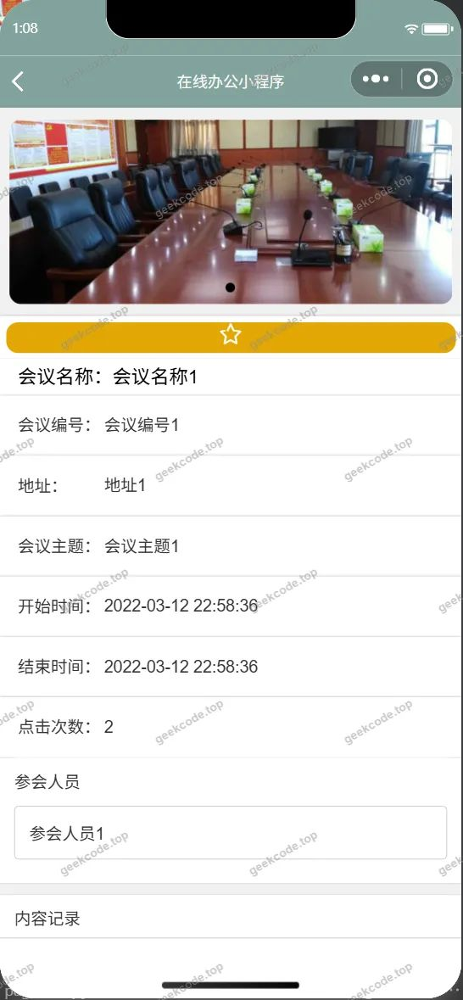</a><figcaption>小程序-会议记录详情</figcaption></figure>
<figure><figcaption>小程序-留言板列表</figcaption></figure>
<figure><a href="https://geekcode.top/archives/%E5%9C%A8%E7%BA%BF%E5%8A%9E%E5%85%AC%E5%B0%8F%E7%A8%8B%E5%BA%8F-%E8%AE%BA%E6%96%87?utm_source=github" title="查看完整源码">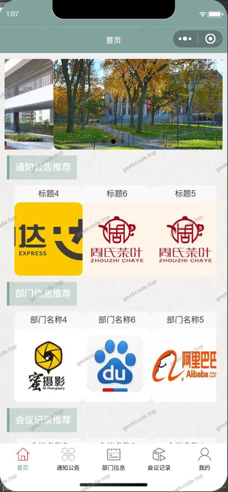</a><figcaption>小程序-首页</figcaption></figure>
<figure><figcaption>小程序-通知公告</figcaption></figure>
<figure><figcaption>小程序-通知公告详情</figcaption></figure>
<figure><figcaption>小程序-忘记密码</figcaption></figure>
<figure><a href="https://geekcode.top/archives/%E5%9C%A8%E7%BA%BF%E5%8A%9E%E5%85%AC%E5%B0%8F%E7%A8%8B%E5%BA%8F-%E8%AE%BA%E6%96%87?utm_source=github" title="查看完整源码">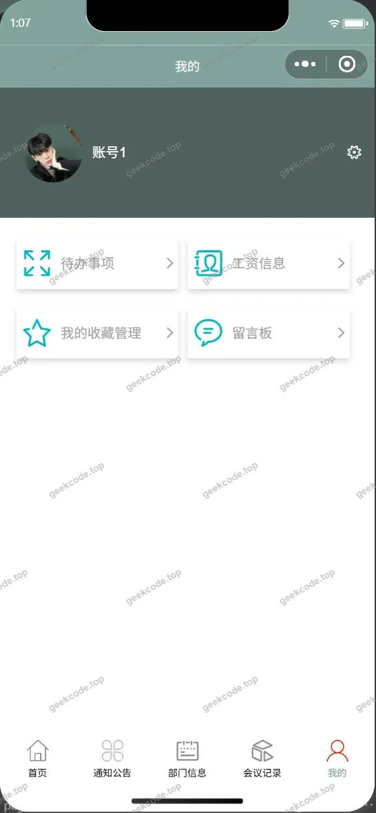</a><figcaption>小程序-我的</figcaption></figure>
<figure><figcaption>小程序-我的收藏列表</figcaption></figure>
<figure><a href="https://geekcode.top/archives/%E5%9C%A8%E7%BA%BF%E5%8A%9E%E5%85%AC%E5%B0%8F%E7%A8%8B%E5%BA%8F-%E8%AE%BA%E6%96%87?utm_source=github" title="查看完整源码">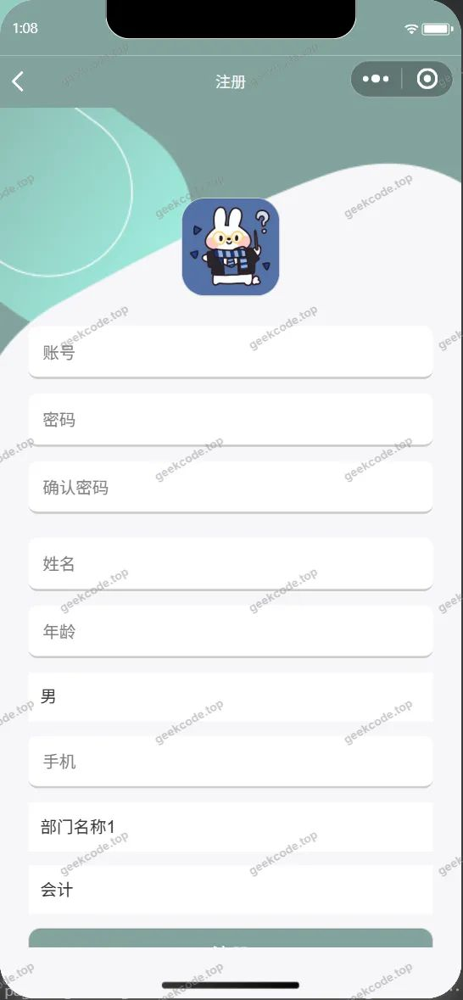</a><figcaption>小程序-注册</figcaption></figure>

<h3>微信小程序管理端</h3>

<figure><figcaption>小程序-管理端-员工列表</figcaption></figure>
<figure><a href="https://geekcode.top/archives/%E5%9C%A8%E7%BA%BF%E5%8A%9E%E5%85%AC%E5%B0%8F%E7%A8%8B%E5%BA%8F-%E8%AE%BA%E6%96%87?utm_source=github" title="查看完整源码">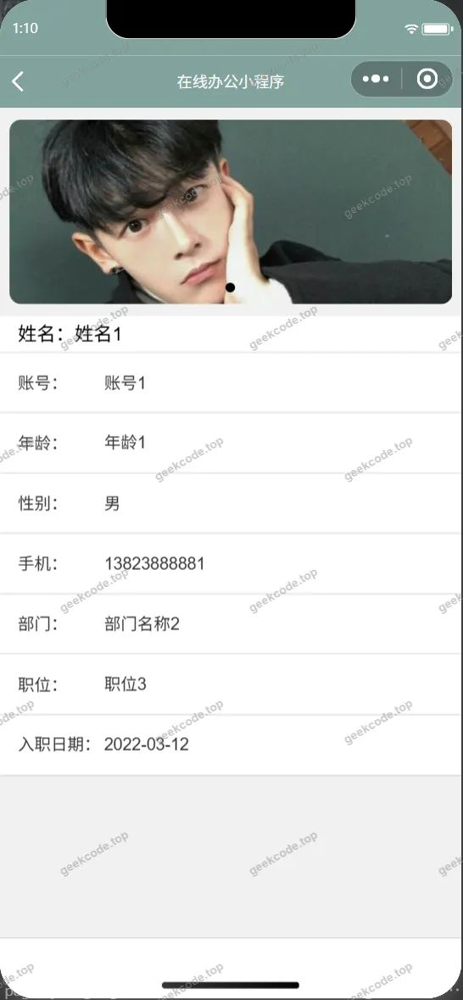</a><figcaption>小程序-管理端-员工详情</figcaption></figure>
<figure><figcaption>小程序-管理端-职位信息列表</figcaption></figure>

<h3>后台管理端</h3>
<h4>后台-部门信息</h4>

<a href="https://geekcode.top/archives/%E5%9C%A8%E7%BA%BF%E5%8A%9E%E5%85%AC%E5%B0%8F%E7%A8%8B%E5%BA%8F-%E8%AE%BA%E6%96%87?utm_source=github" title="查看完整源码">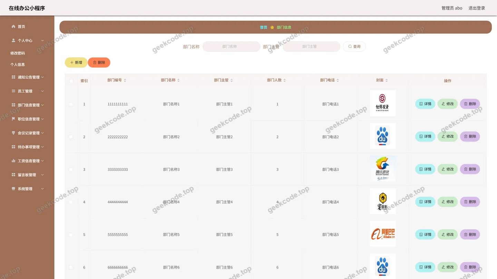</a>

<h4>后台-登录页</h4>

<h4>后台-工资信息</h4>

<a href="https://geekcode.top/archives/%E5%9C%A8%E7%BA%BF%E5%8A%9E%E5%85%AC%E5%B0%8F%E7%A8%8B%E5%BA%8F-%E8%AE%BA%E6%96%87?utm_source=github" title="查看完整源码">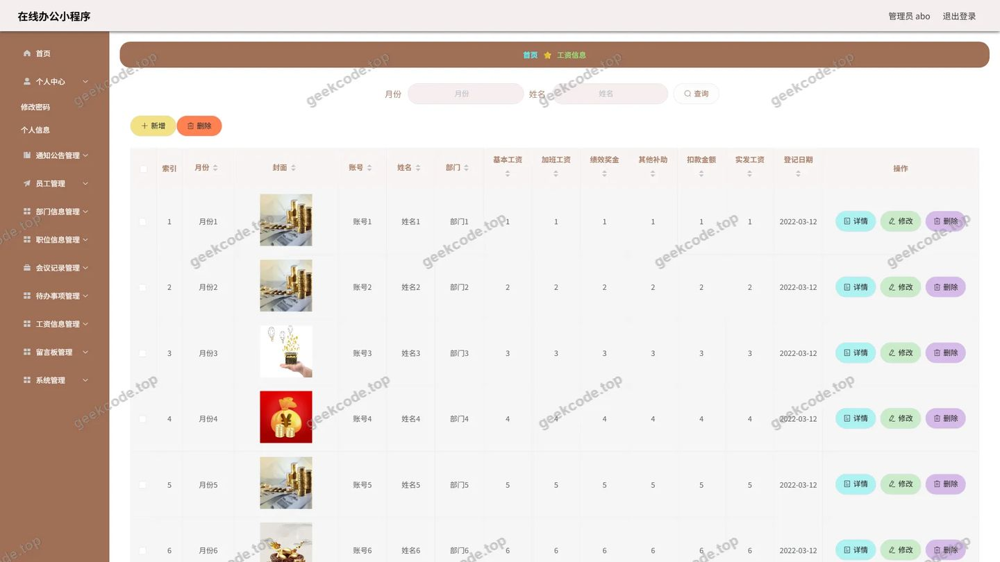</a>

<h4>后台-留言板</h4>

<a href="https://geekcode.top/archives/%E5%9C%A8%E7%BA%BF%E5%8A%9E%E5%85%AC%E5%B0%8F%E7%A8%8B%E5%BA%8F-%E8%AE%BA%E6%96%87?utm_source=github" title="查看完整源码">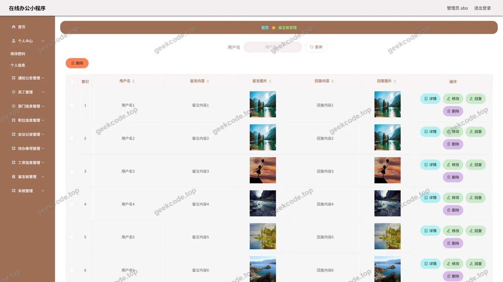</a>

<h4>后台首页</h4>

<a href="https://geekcode.top/archives/%E5%9C%A8%E7%BA%BF%E5%8A%9E%E5%85%AC%E5%B0%8F%E7%A8%8B%E5%BA%8F-%E8%AE%BA%E6%96%87?utm_source=github" title="查看完整源码">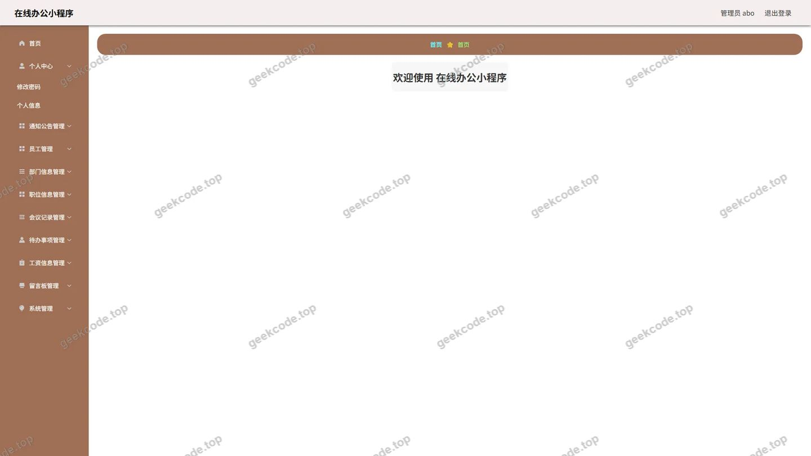</a>

<h4>后台-通知公告</h4>

<a href="https://geekcode.top/archives/%E5%9C%A8%E7%BA%BF%E5%8A%9E%E5%85%AC%E5%B0%8F%E7%A8%8B%E5%BA%8F-%E8%AE%BA%E6%96%87?utm_source=github" title="查看完整源码">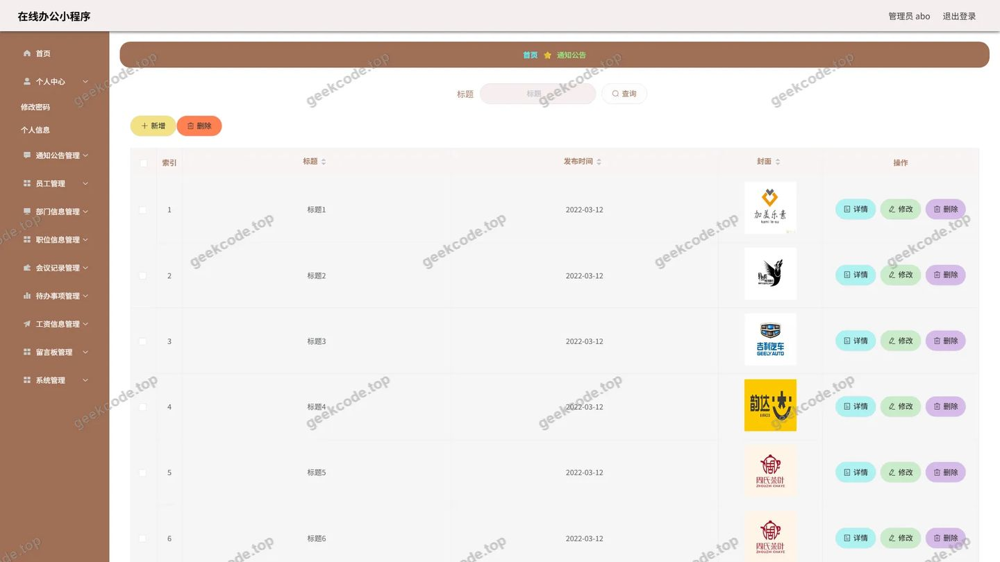</a>

<h4>后台-员工</h4>

<a href="https://geekcode.top/archives/%E5%9C%A8%E7%BA%BF%E5%8A%9E%E5%85%AC%E5%B0%8F%E7%A8%8B%E5%BA%8F-%E8%AE%BA%E6%96%87?utm_source=github" title="查看完整源码">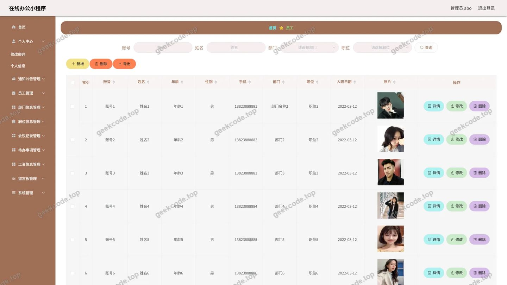</a>

<h4>后台-职位信息</h4>

<a href="https://geekcode.top/archives/%E5%9C%A8%E7%BA%BF%E5%8A%9E%E5%85%AC%E5%B0%8F%E7%A8%8B%E5%BA%8F-%E8%AE%BA%E6%96%87?utm_source=github" title="查看完整源码">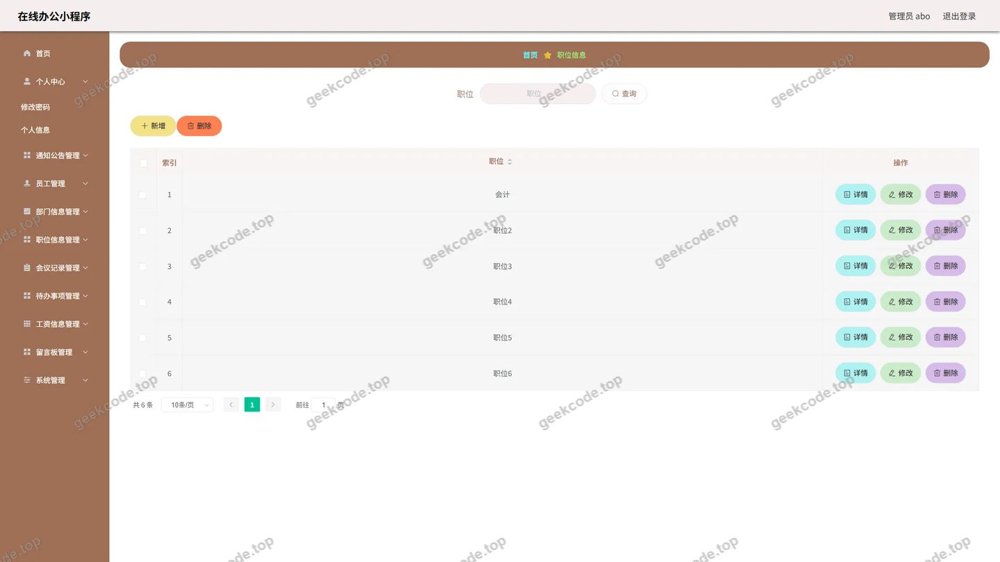</a>

---

## 获取完整源码

| 项目 | 说明 |
| --- | --- |
| 项目名 | 在线办公小程序--论文 |
| 运行截图 | 本文 29 张（站点带水印原图，仓库 `images/` 目录） |
| 完整源码 | [https://geekcode.top/archives/%E5%9C%A8%E7%BA%BF%E5%8A%9E%E5%85%AC%E5%B0%8F%E7%A8%8B%E5%BA%8F-%E8%AE%BA%E6%96%87?utm_source=github](https://geekcode.top/archives/%E5%9C%A8%E7%BA%BF%E5%8A%9E%E5%85%AC%E5%B0%8F%E7%A8%8B%E5%BA%8F-%E8%AE%BA%E6%96%87?utm_source=github) |
| 咨询微信 | **ir9372**（备注：jingpin-yuanma） |
| 更多项目 | [极客代码 geekcode.top](https://geekcode.top/?utm_source=github) |

> 需要源码、部署、改配置、跑不起来等问题，加微信 ir9372 沟通，说明项目名即可。
